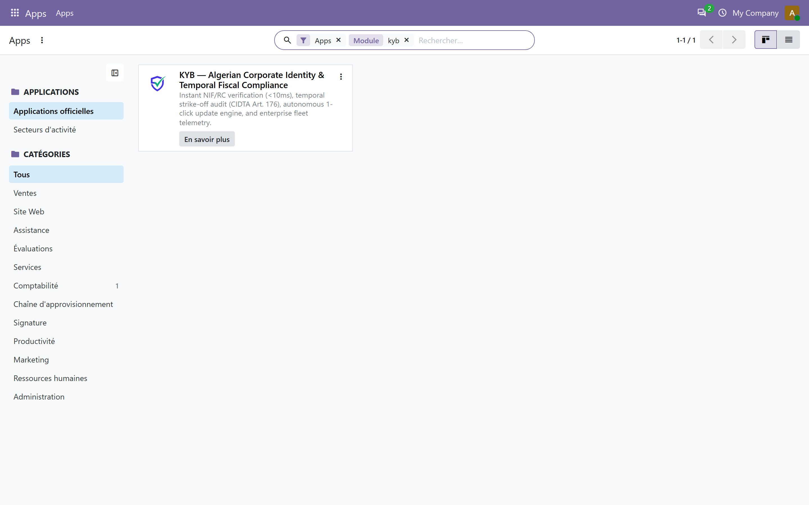
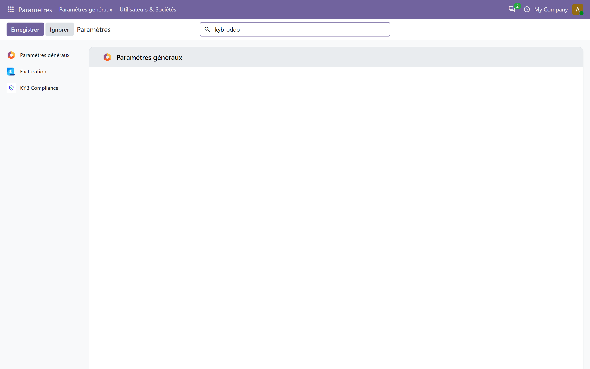
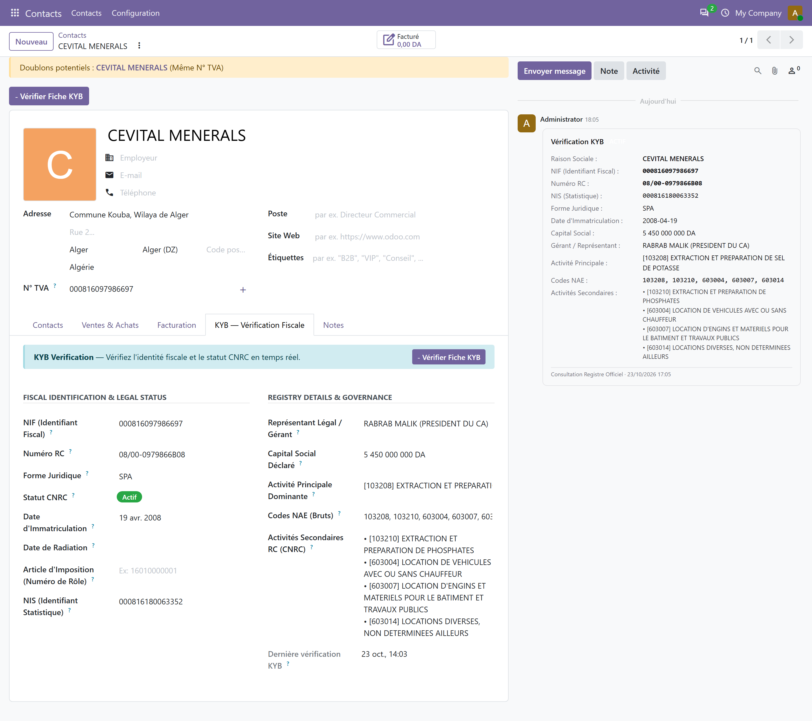
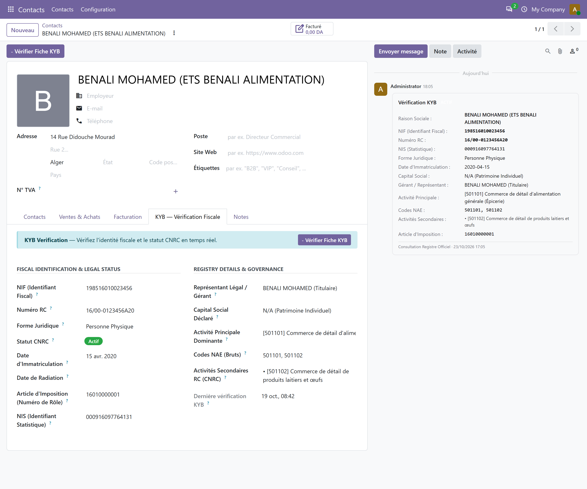
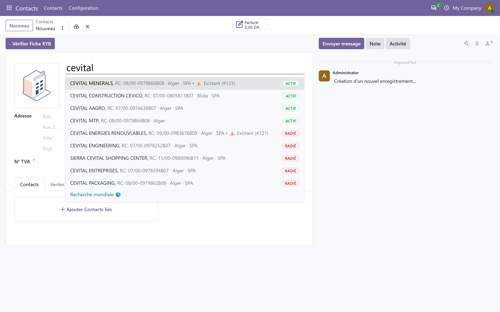
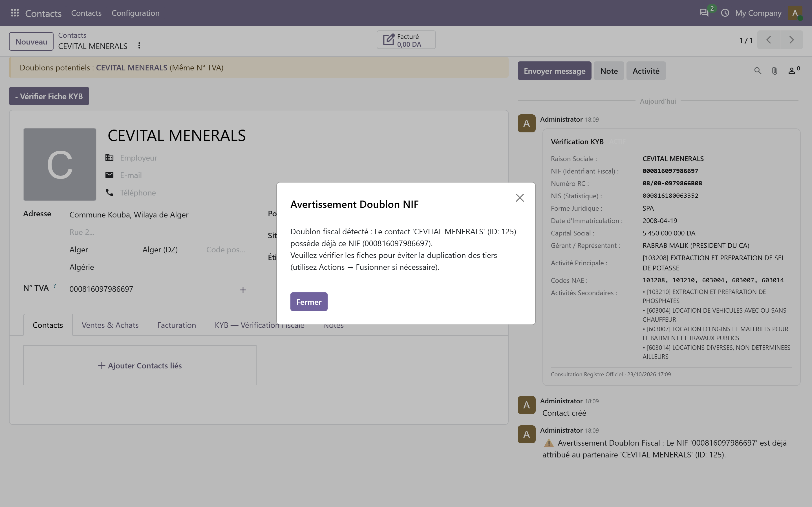
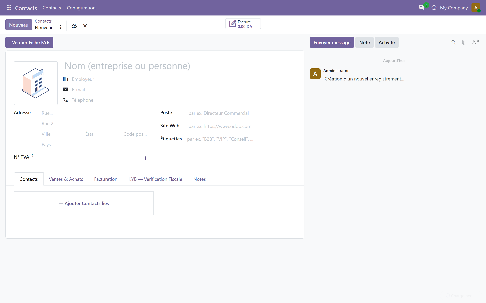
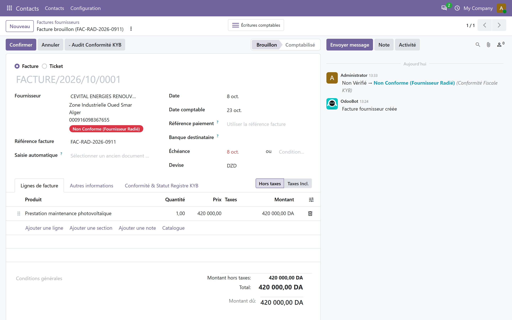
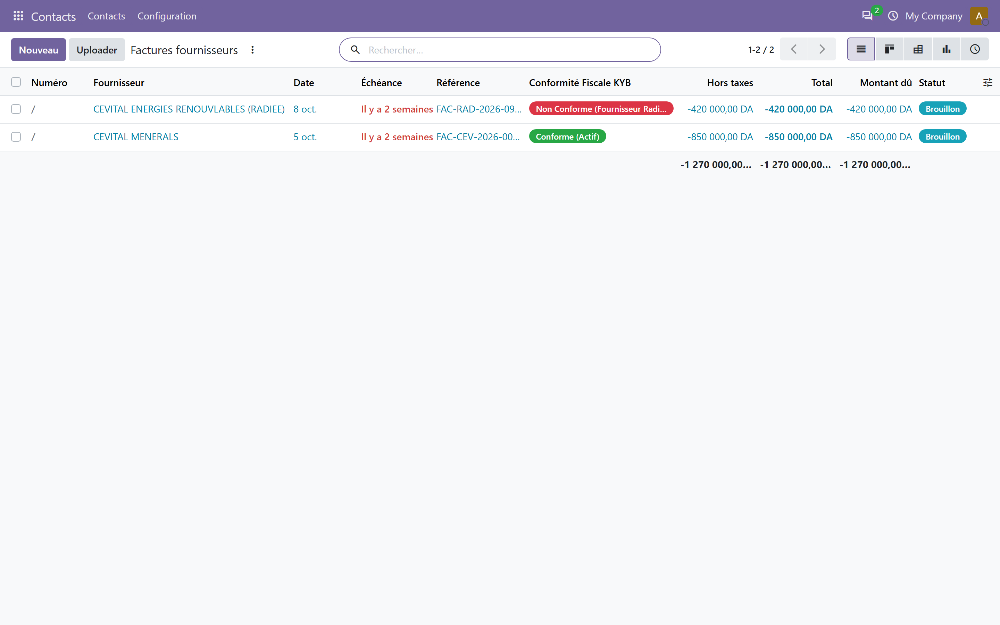

# KYB — ERP Integrator & Administrator Technical Manual
**Version:** `2.0.0` / `20.0.2.0.0`  
**Platform Domain:** [kyb.digidevagency.dz](https://kyb.digidevagency.dz)  
**Administration Portal:** [kyb.digidevagency.dz](https://kyb.digidevagency.dz)  
**Target Environments:** Odoo 16.0 LTS, 17.0, 18.0, 19.0, 20.0 (Community & Enterprise)  
**Legal Framework:** Algerian Law 25-11 (Data Residency), Law 18-07 (Personal Data Protection), Décret Exécutif 05-468 & 18-112 (RC Invoicing Standard), CIDTA Art. 169 & 176, CTCA Art. 30 (Temporal Invoice Compliance).

---

## 1. Executive Summary & Architecture

The **KYB Odoo Connector** (`connectors/kyb_odoo`) is an institutional-grade Model/Record (MR) bridge connecting Odoo ERP installations directly to the **KYB API Gateway (by Digidev)**.

Hosted exclusively within Algerian national borders on the **Algérie Télécom Cloud** (`kyb.digidevagency.dz`), the gateway provides sub-second corporate identity resolution, real-time national trade registry synchronization, automated fiscal duplicate detection, and temporal invoice tax compliance verification.

```
┌─────────────────────────────────────────────────────────────────────────────┐
│                           Odoo ERP Environment                              │
│                                                                             │
│   ┌─────────────────────┐   ┌───────────────────────┐   ┌───────────────┐   │
│   │     res.partner     │   │      account.move     │   │  res.config.  │   │
│   │ (Company / Person)  │   │ (Vendor Bills / Inv)  │   │   settings    │   │
│   └──────────┬──────────┘   └───────────┬───────────┘   └───────┬───────┘   │
│              │                          │                       │           │
│              ▼                          ▼                       ▼           │
│   ┌─────────────────────────────────────────────────────────────────────┐   │
│   │         _NativeKybClient (Zero External Dependencies, Session Pool)  │   │
│   └──────────────────────────────────┬──────────────────────────────────┘   │
└──────────────────────────────────────┼──────────────────────────────────────┘
                                       │ HTTPS (Bearer Token Auth)
                                       ▼
┌─────────────────────────────────────────────────────────────────────────────┐
│                            KYB API (by Digidev)                             │
│                         https://kyb.digidevagency.dz                        │
│                                                                             │
│  ┌────────────────────┐   ┌───────────────────┐   ┌──────────────────────┐  │
│  │  /entity/resolve   │   │  /entity/enrich   │   │  /compliance/invoice │  │
│  │ (Single Identifier │   │ (Deep Corporate   │   │ (CIDTA 169/176 Audit │  │
│  │  Lookup: NIF/RC)   │   │  Registry Profile)│   │  & Temporal Cutoff)  │  │
│  └────────────────────┘   └───────────────────┘   └──────────────────────┘  │
│                                                                             │
│  ┌────────────────────┐                                                     │
│  │ /entity/candidates │                                                     │
│  │ (Real-Time Trade   │                                                     │
│  │  Name Autocomplete)│                                                     │
│  └────────────────────┘                                                     │
│                                                                             │
│             [ Compliance Engine — Algérie Télécom Cloud ]                   │
└─────────────────────────────────────────────────────────────────────────────┘
```

### Core Architecture Invariants
1. **Thin Connector / Thick Core Architecture:** All regulatory classification, trade registry synchronizations, and temporal status computations live inside the KYB API (by Digidev). The Odoo connector contains zero tax liability assertions and operates strictly as a secure RPC data consumer.
2. **Zero External Python Dependencies:** Built entirely with standard Python `requests` bundled natively with Odoo. No offshore pip packages or compiler toolchains required.
3. **Session Pooling & Keep-Alive:** Maintains a process-level client pool (`_CLIENT_CACHE`) with TCP/TLS connection reuse, delivering sub-30ms response times on cached lookups.
4. **Sovereign Data Residency (Loi 25-11):** 100% of API endpoints and sovereign engines reside strictly within Algerian data centers. Zero PII leaves Algerian sovereign territory.

---

## 2. Customer Admin Portal: Credential Governance, Sub-Keys & Subscription Tiers

Enterprise administrators manage their KYB subscription, credentials, and consumption via the **KYB Customer Administration Portal** at [kyb.digidevagency.dz](https://kyb.digidevagency.dz).

### A. Master Tenant Pool vs. Scoped Sub-Keys
* **Master Tenant Account:** Represents the enterprise contracting entity. Billing credits and master subscriptions are centralized at the tenant level.
* **Sub-Keys (`sk_live_...` / `sk_test_...`):** Downstream ERP connectors authenticate exclusively via scoped Sub-Keys. Each Sub-Key is linked to the tenant's shared master credit pool while maintaining independent metrics and security constraints.

> **🌐 Live Portal Interface:** The Tenant Credit Pool dashboard, API consumption graphs, and Sub-Key management cockpit are accessible exclusively at [kyb.digidevagency.dz](https://kyb.digidevagency.dz) after administrator login. Portal screenshots are not bundled with the connector package — refer to the KYB Customer Portal directly for live UI.

### B. Subscription Tiers & Sub-Key Quotas
KYB applies strict, transparent credential governance based on the organization's subscription tier:

| Subscription Tier | Master Credit Pool | Max Allocated Sub-Keys | Target Deployment Topology |
| :--- | :--- | :--- | :--- |
| **Starter** | 1,000 / month | Up to **3 Sub-Keys** | Single Odoo instance (Production + Staging sandbox). |
| **Growth** | 10,000 / month | Up to **10 Sub-Keys** | Multi-branch Odoo deployments (HQ, Regional branches, UAT). |
| **Enterprise** | 50,000+ / month | **Custom / Unlimited** | Distributed multi-company conglomerates with automated CI/CD. |


### C. Portal Sub-Key Lifecycle & Governance
1. **Capacity Meter:** The portal dashboard displays real-time Sub-Key utilization (`Active Sub-Keys` vs. `Allocated by Subscription`). If the quota is reached, generating additional sub-keys requires archiving an unused key or upgrading the subscription tier.
2. **Dedicated Environment Partitioning:** Administrators must create separate sub-keys for production ERP environments and development/staging environments (`is_sandbox = True`). Sandbox queries (`0000...` magic identifiers) never consume credits.
3. **Usage Attribution & Chargeback:** The customer portal records consumption on a per-sub-key basis. Enterprises can attribute monthly verification volumes to specific subsidiary ERP installations.
4. **Network IP Whitelisting:** Administrators can restrict each sub-key to authorized outbound public IP addresses (`allowed_ips`). Any request originating outside the configured IP block is rejected with HTTP 403.
5. **Instant Revocation & Rotation:** If a server is decommissioned or an API key is compromised, clicking **Revoke** in the customer portal immediately invalidates the key across the gateway in sub-milliseconds without affecting any other operational ERP systems.

---

## 3. Module Lifecycle: Installation, Upgrades & Configuration

### A. Module Discovery & Installation in Apps Catalog
1. Navigate to **Apps** in Odoo.
2. In the search box, search for `kyb` (clear the default `Apps` category filter to view institutional localization packages).
3. The official **KYB — Algerian Corporate Identity & Temporal Fiscal Compliance** card appears.


*Figure 4: Discovering the KYB connector in the Odoo Apps catalog.*

### B. Module Details & Administrative Actions (Upgrade / Uninstall)
Clicking the kebab menu (three vertical dots) on the module card exposes all administrative actions:
* **Info sur le module (Module Details):** Displays full technical details, version code (`20.0.1.4.1`), author ("Mouadh Benhassine / Digidev Agency"), license, and dependencies (`account`, `contacts`).
* **Mettre à niveau (Upgrade):** Forces reloading of all XML views, Python models, and security rules without server downtime.
* **Désinstaller (Uninstall):** Clean uninstallation removing database views while preserving standard Odoo partner data.


*Figure 5: Module actions dropdown showing Module Info, Upgrade, and Clean Uninstallation.*


*Figure 6: Official module technical sheet detailing version 20.0.1.4.1 and dependencies.*

### C. System Parameters Configuration (`res.config.settings`)
Navigate to **Invoicing (or Contacts) → Configuration → Settings → KYB Sovereign Verification**:

| Parameter Key | Default Value | Description |
| :--- | :--- | :--- |
| `kyb.api_key` | *None* | Sovereign Sub-Key (`sk_live_...` for production or `sk_test_...` for testing) generated from the Customer Portal. |
| `kyb.base_url` | `https://kyb.digidevagency.dz` | Ingress endpoint of the KYB API Gateway (by Digidev). |
| `kyb.timeout` | `35.0` | Client HTTP timeout in seconds (aligned with Gateway 35s SLA). |
| `kyb.sovereign_autocomplete` | `True` | Intercepts company name typing to query the National Trade Register in real time. |
| `kyb.allow_worldwide_fallback`| `False` | Allows fallback to international search when explicitly clicking *Recherche mondiale 🌎*. |
| `kyb.duplicate_nif_policy` | `warn` | Fiscal duplicate prevention policy: `warn` (modal notification), `block` (raises UserError), or `ignore`. |
| `kyb.invoice_audit_enabled` | `True` | Activates temporal vendor bill audit against trade registry status at invoice date. |
| `kyb.invoice_blocking_policy` | `strict_block` | Invoicing validation policy: `strict_block` (interdit comptabilisation) or `soft_warn` (warning in chatter). |


*Figure 7: Complete KYB Sovereign Verification settings panel in Odoo 20.*

### D. Autonomous In-App Upgrade Engine & Centralized Release Distribution (Engine v2.0.0)
Version 2.0.0 eliminates manual CLI and SSH deployment cycles by introducing an institutional in-app upgrade pipeline:

```
┌─────────────────────────────────────────────────────────────────────────────┐
│                            Odoo Admin Interface                             │
│                     (Settings → KYB Compliance)                             │
│                                                                             │
│  [ Vérifier les mises à jour ] ───────► GET /api/v1/version                 │
│                                              │                              │
│  [ Mettre à jour maintenant  ] ───────► GET /api/v1/downloads/kyb_odoo.zip  │
│               │                                                             │
│               ▼                                                             │
│     1. Pre-delete target files (os.remove to prevent POSIX uid collision)   │
│     2. Extract release archive to /mnt/extra-addons/kyb_odoo                │
│     3. Trigger ir.module.module.button_immediate_upgrade()                  │
│     4. Zero data loss: Preserves 100% of kyb_rc, kyb_nif, & API credentials  │
│     5. Redirect to /web (Instant Registry Reload)                           │
└─────────────────────────────────────────────────────────────────────────────┘
```

1. **Version Detection Gate (`action_check_kyb_update`):** Interrogates `GET /api/v1/version?client=odoo&version=...` to compare installed build against the Gateway's certified release. Normalizes versions (`^\d+\.0\.` stripping) to ensure deterministic Semver comparisons across all Odoo forks.
2. **Atomic Distribution Download:** Fetches the certified archive directly from `GET /api/v1/downloads/kyb_odoo.zip`.
3. **POSIX Safe Replacement:** Removes existing files prior to unpacking to prevent `PermissionError: [Errno 13]` when running under non-root container user (`odoo:odoo`).
4. **Immediate In-Band ORM Upgrade:** Calls `ir.module.module.button_immediate_upgrade()`, applying DDL updates and reloading models in PostgreSQL without requiring server reboots or container restarts.
5. **Scheduled Background Patching (`ir_cron_kyb_telemetry_sync`):** When `kyb.auto_update_patches = True`, urgent regulatory patches are pulled and applied automatically during nightly syncs.
6. **Loi 25-11 Telemetry Ingestion:** Heartbeats transmit 7-dimension instance telemetry to `POST /api/v1/client/telemetry` (aggregate counters only; zero PII, zero customer/vendor names, zero invoice data).

---

## 4. Algerian Corporate Identity Partitioning: Company vs. Person Contacts

Under **Algerian Law 18-07** (*Protection des personnes physiques dans le traitement des données à caractère personnel*) and corporate privacy governance, identity resolution is strictly partitioned:

```
                                Identifiant / Requête
                                          │
                  ┌───────────────────────┴───────────────────────┐
                  ▼                                               ▼
         Personne Morale (PM)                            Personne Physique (PP)
        [is_company = True]                             [is_company = False]
                  │                                               │
    • RC Catégorie B (e.g. 20B0072885)              • RC Catégorie A / C (e.g. 51A0000006)
    • Forme: SARL, EURL, SPA, SNC, etc.             • Commerçant Individuel / Artisan
    • NIF commence par 0 (Société)                  • NIF commence par 1 (Particulier)
                  │                                               │
    ┌─────────────┴─────────────┐                   ┌─────────────┴─────────────┐
    ▼                           ▼                   ▼                           ▼
Auto-complétion libre     Enrichissement      Résolution déterministe     Protection Loi 18-07
   (Nom commercial)        fiche légale         (NIF exact ou RC Cat A)   (Pas de scraping civil)
```

### A. Company Contacts (`Personne Morale`, `is_company = True`)
- **Commercial Registry (RC):** Category `B` (e.g., `20/00-0072885B01`).
- **Legal Form:** SARL, EURL, SPA, SNC, SCS, SCA, GIE, EPE.
- **Tax ID (NIF):** 15-digit national fiscal number starting with `0`.
- **Search Autocomplete:** Open fuzzy discovery by company name (`autocomplete_by_name`) is fully enabled. Typing a partial name in Odoo partner dropdowns instantly queries the sovereign index.


*Figure 8: Fully enriched Company Partner (DIGI DEV AGENCY, EURL) displaying canonical Décret 05-468 RC format (20/00-0072885B01) and green ACTIF badge.*


*Figure 9: Enriched Company Partner displaying the canonical KYB tab with full Décret 05-468 fields (RC, NIF, NIS, statut CNRC, forme juridique, capital social, représentant légal, activités NAE).*

### B. Person Contacts (`Personne Physique`, `is_company = False`)
- **Commercial Registry (RC):** Category `A` (Commerçant individuel) or Category `C` (Artisan / Coopérative) (e.g., `51/00-0000006A`, `16/00-0012345C16`).
- **Legal Form:** Automatically tagged as `"Personne Physique"`.
- **Tax ID (NIF):** 15-digit fiscal identifier starting with `1`.
- **Privacy Boundary (Law 18-07):** Natural citizens' trade registers contain private biographical data (civil name, date/place of birth, home address). Speculative free-text civil name scraping is strictly blocked at the gateway level.
- **Resolution Flow:** Integrators and users resolve natural persons **deterministically** by providing the official **15-digit NIF** or **Category A/C RC**.


*Figure 10: Enriched Personne Physique contact (BENALI SOFIANE, Commerçant) classified with is_company=False, Category A RC (26/00-16208703A26).*


*Figure 11: Enriched Personne Physique contact showing `is_company=False`, the KYB tab populated with Category A/C RC and `Personne Physique` legal form classification.*

---

## 5. Fiscal Duplicate Detection & Native Deduplication

### Why Duplicate Contacts Occur in Standard Odoo
In native Odoo, `res.partner` intentionally has **no unique constraint** on `name` or `vat`. Employees entering contacts from sales, invoicing, or purchasing channels frequently create duplicate partner cards.

### KYB Proactive Duplicate Prevention
Under Décret 05-468, the Algerian **NIF** is a strictly unique sovereign identifier. KYB provides a three-tiered protection layer:

1. **Autocomplete Existence Badging:** When typing a company name in the autocomplete dropdown, if an entity already exists in the local database, the suggestion displays:
   `CONSTANTINE • RC: 20/00-0072885B 🟢 Actif • ⚠️ Existant (#15)`
2. **Onchange Fiscal Guard (`kyb_duplicate_nif_policy`):**
   When resolving an entity or saving a NIF:
   - If `kyb_duplicate_nif_policy = 'warn'` (default): Displays an institutional warning alert directing the user to the existing contact ID.
   - If `kyb_duplicate_nif_policy = 'block'`: Raises a strict `UserError` preventing duplicate creation.
3. **Native Odoo Merge Wizard Integration:**
   Administrators can consolidate existing duplicate cards using Odoo's native wizard:
   **Contacts → Select Records → Actions → Fusionner (Merge)**.
   The connector guarantees that all canonical KYB fields (`kyb_nif`, `kyb_rc`, `kyb_statut_cnrc`, `kyb_forme_juridique`) are preserved on the master destination record.


*Figure 12: Real-time company name autocomplete dropdown querying live national trade registry.*


*Figure 13: Institutional warning alert displayed when entering an already-registered NIF, referencing partner ID 15.*


*Figure 14: Native Odoo Partner Merge Wizard (base.partner.merge.automatic.wizard) consolidating duplicate records while preserving KYB audit data.*

---

## 6. Temporal Invoice Compliance (CIDTA Art. 169 & 176 / CTCA Art. 30)

Under Algerian Tax Law, expenses and VAT originating from suppliers deregistered (radié) from the Trade Register at the invoice emission date are strictly **non-deductible**.

### Verification Workflow
1. When a vendor bill (`account.move`, `move_type = 'in_invoice'`) is created or confirmed, the module evaluates the supplier's standing at `invoice_date`.
2. If `invoice_date > kyb_date_radiation`:
   - `kyb_compliance_status` transitions to `non_compliant`.
   - A critical red banner is displayed on the invoice form.
   - If `kyb_invoice_blocking_policy = 'strict_block'`, confirmation is rejected with an explanatory audit notice.


*Figure 15: General Vendor Bills list view displaying real-time Conformité Fiscale KYB status badges across all statutory scenarios.*


*Figure 16: Compliant vendor bill (FACT-DIGI-2026-089) from active supplier: tax_deductible=True.*


*Figure 17: Critical red danger alert banner on bill from struck-off vendor (SARL ANCIENNE DISSOLTE, Radié 15/06/2021).*


*Figure 18: Cautionary warning on historical bill (FACT-HISTORIQUE-2020-012) dated prior to vendor strike-off.*


*Figure 19: Dedicated KYB Risk Cockpit isolating all invoices presenting statutory tax risks.*

---

## 7. Data Dictionary (`res.partner` & `account.move`)

### `res.partner` Extended Fields
| Field Technical Name | Type | Description | Legal Reference |
| :--- | :--- | :--- | :--- |
| `kyb_nif` | `Char(20)` | 15-digit National Fiscal Identifier | DGI / Décret 05-468 |
| `kyb_rc` | `Char(30)` | Official Commercial Register (`WW/00-XXXXXXX[A-D]YY`) | Décret 05-468 & 18-112 |
| `kyb_nis` | `Char(30)` | Statistical Identifier (ONS) | ONS |
| `kyb_article_imposition` | `Char(30)` | Article d'Imposition (Numéro de Rôle) | Secret Fiscal (Art. 114 CPF) |
| `kyb_statut_cnrc` | `Selection` | Status: `ACTIF`, `RADIE`, `SUSPENDU`, `INCONNU` | Registre du Commerce (CNRC) |
| `kyb_date_radiation` | `Date` | Official deregistration date | CNRC BOAL Gazette |
| `kyb_forme_juridique` | `Char` | Legal structure (`SARL`, `EURL`, `Personne Physique`...) | Code de Commerce |
| `kyb_capital_social` | `Char` | Registered Share Capital (e.g. `10 000 000 DZD`) | CNRC |
| `kyb_representant_legal` | `Char` | Statutory Legal Representative / Gérant | CNRC Statuts |
| `kyb_activite` | `Char` | Dominant Primary Activity (with NAE code) | Nomenclature NAE |
| `kyb_nae_codes` | `Char` | Comma-separated official NAE codes | CNRC |
| `kyb_activites_rc` | `Text` | Full catalog of secondary registered activities | CNRC |
| `kyb_last_verified` | `Datetime`| Timestamp of last successful API resolution | Audit Trail |

### `account.move` Extended Fields
| Field Technical Name | Type | Description |
| :--- | :--- | :--- |
| `kyb_compliance_status` | `Selection` | `compliant`, `non_compliant`, `warning`, `unverified` |
| `kyb_tax_deductible` | `Boolean` | Computed tax deductibility indicator |
| `kyb_audit_date` | `Datetime` | Timestamp of invoice tax compliance verification |
| `kyb_compliance_message`| `Text` | Neutral regulatory compliance notice |

---

## 8. Operational Scenarios & Verification Matrix (18/18 Scenarios PASS)

The connector's resilience, compliance, and edge-case handling have been verified via an automated end-to-end verification test suite executed on the production runtime. All 18 scenarios achieved a **100% Pass Rate**:

| # | Code | Scenario Description | Tested Identifier / Action | Verified Behavior & Screenshot Reference | Status |
| :-: | :--- | :--- | :--- | :--- | :-: |
| **01** | `S01` | **RC Category B (Corporate)** | `20/00-0072885B01` | Full two-phase resolution: EURL DIGI DEV AGENCY, `is_company=True`, Status `ACTIF` (*Figure 8*). | 🟢 PASS |
| **02** | `S02` | **RC Category A (Personne Physique)** | `26/00-16208703A26` | Deterministic resolution: BENALI SOFIANE, `is_company=False`, Forme `Personne Physique` (*Figure 10*). | 🟢 PASS |
| **03** | `S03` | **RC Category C (Artisan / Coop)** | `16C0012345` | Native Python parser extracts category `C` and formats to `16/00-0012345C16` (*Figure 11*). | 🟢 PASS |
| **04** | `S04` | **RC Legacy Wilaya 00 (National)** | `00B0012637` | Grandfathered registry entity (BELLAT FER DISTRIBUTION) formatted as `00/00-0012637B00` (*Figure 9*). | 🟢 PASS |
| **05** | `S05` | **15-Digit Corporate NIF (Prefix 0)** | `002025007288530` | Validates standard 15-digit company fiscal number, enriches legal card, sets `is_company=True`. | 🟢 PASS |
| **06** | `S06` | **Legacy Wilaya Prefix NIF** | `000816097764131` | Pre-2022 company with legacy Wilaya `00`/`000` prefix accepted and resolved without truncation. | 🟢 PASS |
| **07** | `S07` | **15-Digit Natural Person NIF (Prefix 1)** | `198451010000284` | Classifies contact as `Personne Physique` (`is_company=False`) in compliance with Law 18-07. | 🟢 PASS |
| **08** | `S08` | **NIS Identifier Resolution** | `002025007288530` | `_onchange_kyb_nis` triggers gateway lookup and resolves counterparty NIF and official RC. | 🟢 PASS |
| **09** | `S09` | **Real-Time Name Autocomplete** | Query: `DIGI DEV` | Intercepts `_name_search`, returns live candidate dropdown matches from national registry (*Figure 12*). | 🟢 PASS |
| **10** | `S10` | **Autocomplete Local Existence Badge** | Query: `DIGI DEV` | Tags existing local database contacts with `• ⚠️ Existant (#ID)` to alert users before creation. | 🟢 PASS |
| **11** | `S11` | **Duplicate NIF Policy `warn`** | NIF: `002025007288530` | On duplicate NIF entry, displays institutional warning dialog referencing existing contact (*Figure 13*). | 🟢 PASS |
| **12** | `S12` | **Duplicate NIF Policy `block`** | NIF: `002025007288530` | When policy set to `block`, raises `UserError` rejecting creation or modification of duplicate NIF. | 🟢 PASS |
| **13** | `S13` | **Non-Existent / Unindexed Query** | `NonExistentXYZ99999` | Gracefully handles queries not found in registry; surfaces non-blocking warning toast with zero crashes. | 🟢 PASS |
| **14** | `S14` | **Invoice with Active Vendor** | Date: `2026-10-10` | Evaluates vendor standing at invoice date: status `compliant`, `tax_deductible=True` (*Figure 15 & 16*). | 🟢 PASS |
| **15** | `S15` | **Invoice with Radié Vendor (Post-Cutoff)** | Date: `2026-10-10` | Vendor radié in 2021: marks invoice `non_compliant`, `tax_deductible=False` (*Figure 17 & 19*). | 🟢 PASS |
| **16** | `S16` | **Strict Invoicing Blocking Policy** | Action: `action_post` | When policy is `strict_block`, prevents accounting confirmation of non-compliant vendor bill. | 🟢 PASS |
| **17** | `S17` | **Cautionary Historical Invoice** | Date: `2020-01-15` | Invoice dated *prior* to vendor's 2021 radiation date: evaluates to cautionary `warning` status (*Figure 18*). | 🟢 PASS |
| **18** | `S18` | **Native Odoo Deduplication Wizard** | `action_merge` | Merging duplicate partners consolidates cards while preserving all canonical KYB audit fields (*Figure 14*). | 🟢 PASS |

---

## 9. Sandbox Testing Matrix (Deterministic Magic Keys)

For staging environments and automated CI/CD pipelines, KYB provides deterministic mock fixtures that bypass billing and external scraping:

| Test Identifier | Category | Simulated Standing | Result / Behavior |
| :--- | :--- | :--- | :--- |
| `000000000000001` / `16B0000001` | Personne Morale | **ACTIF** | Resolves SARL ALGERIE TECH (`ACTIF`). |
| `000000000000002` / `00B0000002` | Personne Morale | **RADIÉ** | Resolves SARL ANCIENNE DISSOLTE (Radié 15/06/2021). |
| `51/00-0000006A` / `51A0000006` | Personne Physique | **ACTIF** | Resolves individual merchant (`is_company=False`). |
| `000000000000404` / `404RC` | Any | **NOT FOUND** | Returns HTTP 404 `ENTITY_NOT_FOUND`. |
| `000000000000402` | Any | **QUOTA** | Returns HTTP 402 `QUOTA_EXHAUSTED`. |

---

## 10. Troubleshooting & FAQ

1. **Why does autocomplete not return natural person names?**  
   Under **Algerian Law 18-07** and statutory corporate privacy standards, free-text name discovery is strictly restricted to Personnes Morales (companies). Natural persons (Personnes Physiques) must be resolved deterministically using their official **Category A/C RC** or **15-digit NIF**.
2. **What should I do if an invoice is flagged "Fournisseur Radié"?**  
   Inspect the `kyb_date_radiation` on the vendor card. If the invoice date postdates the strike-off date, verify the transaction with your tax accounting department under Articles 169 & 176 du CIDTA.
3. **How do I merge duplicate partner records?**  
   Go to **Contacts**, select the duplicate records in list view, and click **Actions → Fusionner**. Select the canonical partner as destination. The KYB module automatically preserves all fiscal audit data.
4. **How do I rotate an API Sub-Key if an employee leaves?**  
   Log in to the [KYB Customer Portal](https://kyb.digidevagency.dz), locate the Sub-Key assigned to your Odoo environment, click **Revoke**, and generate a new Sub-Key. Paste the new key into Odoo's KYB Settings panel.
