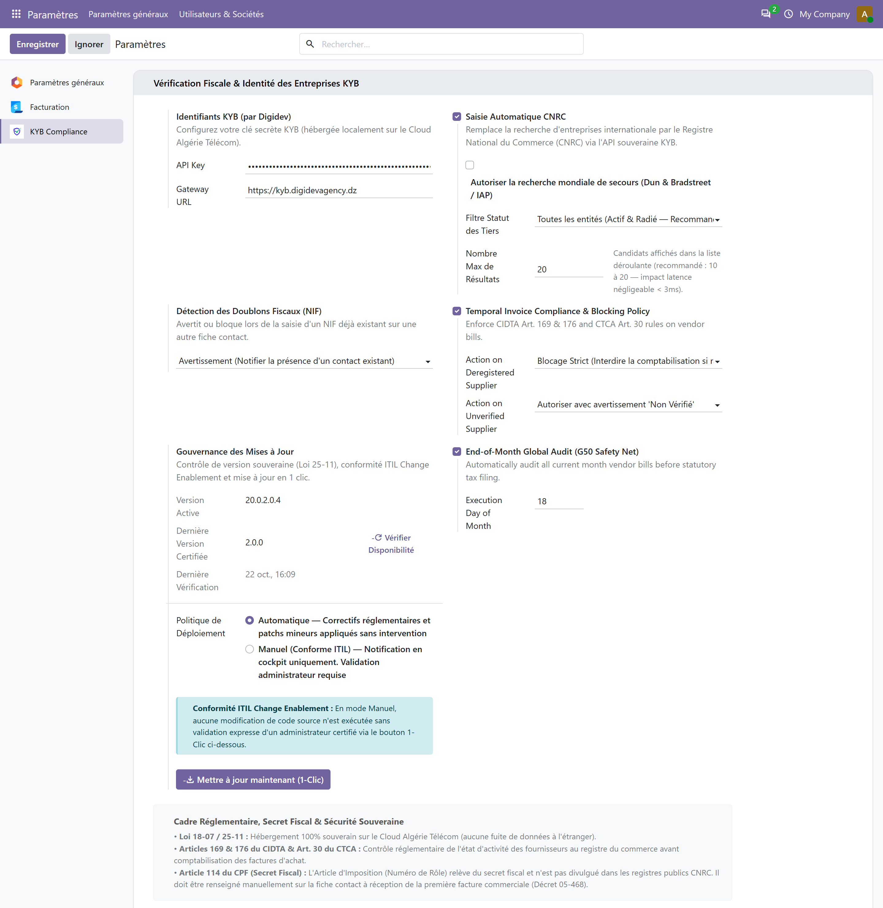
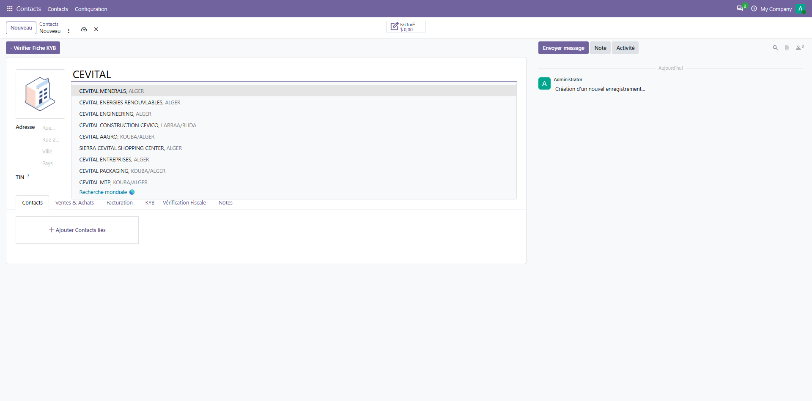
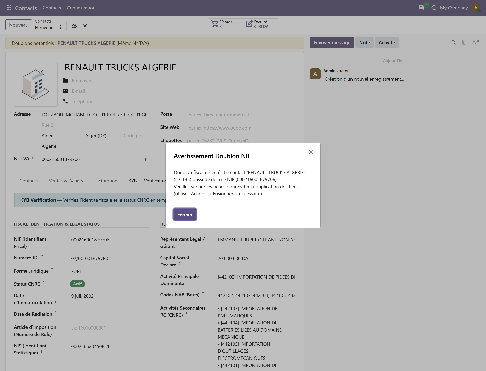
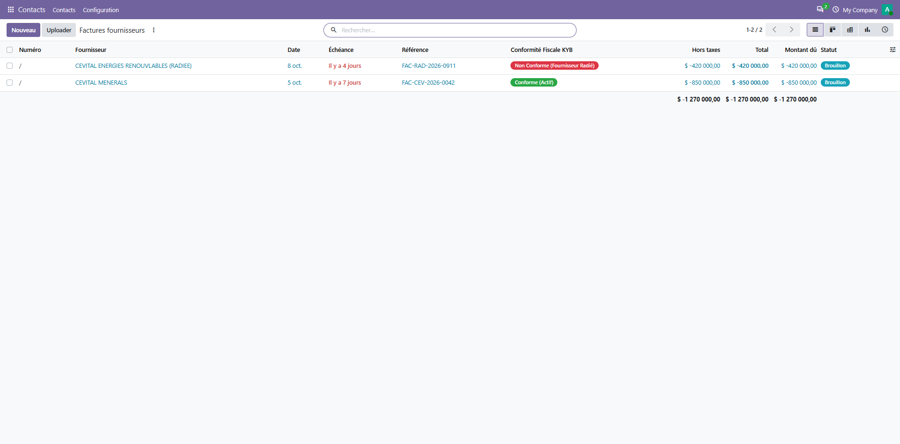

# KYB pour Odoo — Manuel Utilisateur & Guide Pratique
**Version :** `1.4.2` / `20.0.1.4.2`  
**Cible :** Directeurs Financiers (DAF), Responsables Comptables, Gestionnaires Achats & Ventes  
**Portail KYB (by Digidev) :** [kyb.digidevagency.dz](https://kyb.digidevagency.dz)  
**Compatibilité :** Odoo 16.0 LTS, 17.0, 18.0, 19.0, 20.0 (Community & Enterprise)

---

## 1. À propos du module KYB

Le module **KYB pour Odoo** facilite l'identification de vos tiers et accompagne la mise en conformité fiscale de vos pièces comptables en Algérie :

* **Recherche & Auto-complétion en Direct :**
  * **Pour les Personnes Morales (Sociétés) :** Recherche intuitive par raison sociale ou nom commercial (ex: `CEVITAL`) avec auto-complétion instantanée connectée directement aux **portails gouvernementaux publics en direct**.
  * **Pour toutes les entités (Personnes Morales & Personnes Physiques) :** Recherche universelle immédiate par identifiants officiels : **Numéro RC**, **NIF (15 chiffres)** ou **NIS**.
* **Enrichissement Fiscal & Légal en 1 Clic :**  
  Renseignement automatique et structuré des informations officielles : Raison sociale, Forme juridique, NIF (15 chiffres), Registre de Commerce (normalisé Décret 05-468), NIS, Capital social, Dirigeants, Adresse du siège et nomenclature d'activités NAE (principale et secondaires).
* **Vérification de Statut Juridique en Temps Réel :**  
  Consultation en direct de l'état d'activité officiel de chaque partenaire (**Actif**, **Radié**, **Suspendu**) avec inscription d'une note d'audit horodatée dans le fil de discussion (Chatter) pour assurer la traçabilité interne.
* **Assistance au Contrôle Temporel des Factures :**
  * **Achats Fournisseurs :** Contrôle temporel automatique comparant la date d'émission de la facture et le statut d'activité répertorié du fournisseur. Alerte ou blocage configurable en cas de fournisseur radié, contribuant à la protection de la déductibilité de vos charges et de la TVA (Articles 169 & 176 CIDTA / 30 CTCA).
  * **Ventes Clients :** Aide à l'édition de factures comportant les mentions légales obligatoires requises (Décret 05-468) et fiabilisation des données pour votre état 104 des clients.
* **Prévention Proactive des Doublons Fiscaux :**  
  Alerte immédiate à la saisie si un NIF existe déjà dans votre base, évitant l'éclatement des comptes auxiliaires et préservant l'organisation de votre grand livre.
* **Hébergement Souverain & Sécurité des Données :**  
  Infrastructure opérée sur le Cloud Algérie Télécom dans le respect de la législation relative à la souveraineté numérique (Loi 18-07 / Loi 25-11), sans transfert de données vers des serveurs tiers à l'étranger.

---

## 2. Configuration Rapide & Personnalisation des Politiques de Contrôle

La mise en service du connecteur s'effectue en moins de deux minutes dans les paramètres d'Odoo. Le module s'adapte à la politique de gestion des risques de votre entreprise (mode bloquant ou mode alerte).

### Étape 1 : Obtenir votre Clé d'API KYB
1. Connectez-vous à votre espace client institutionnel sur le portail :  
   👉 **[https://kyb.digidevagency.dz](https://kyb.digidevagency.dz)**
2. Accédez à la rubrique **Clés API & Intégrations** (ou **Paramètres Développeur**).
3. Cliquez sur **Générer une clé de production**.  
   *Votre clé se présente sous la forme `sk_live_...`. Conservez-la en lieu sûr.*

### Étape 2 : Activer la passerelle dans Odoo
1. Rendez-vous dans **Paramètres → KYB Compliance** (ou **Conforme KYB → Configuration**).
2. Renseignez les deux champs d'accès :
   * **API Key :** Collez votre clé secrète. Dans l'interface, celle-ci s'affiche sous forme masquée (`•••••••••••••••••••••••••••`) afin de protéger vos identifiants d'entreprise contre toute indiscrétion visuelle.
   * **Gateway URL :** Conservez l'adresse officielle de la passerelle en clair :  
     `https://kyb.digidevagency.dz`

*Figure 1 : Interface de configuration KYB affichant la passerelle officielle en clair et la clé API masquée.*

### Étape 3 : Choisir le niveau de rigueur de vos politiques (Au choix de l'entreprise)

Le module offre un contrôle granulaire pour s'adapter à la gouvernance de chaque direction financière :

| Paramètre | Options Disponibles | Comportement & Recommandation |
| :--- | :--- | :--- |
| **Politique de Validation des Factures** (*Action on Deregistered Supplier*) | • **Blocage Strict (Par défaut / Recommandé)** • **Avertissement (Soft Warning)** | **• Blocage Strict :** Empêche la confirmation comptable (`Confirmer`) d'une facture si le fournisseur était radié des registres officiels à la date d'émission. Vise à prévenir le risque de rejet fiscal. **• Avertissement :** Permet la validation pour les cas d'exception (ex: règlement d'un litige en cours), tout en inscrivant une alerte rouge explicite dans le fil de discussion (Chatter). |
| **Détection des Doublons Fiscaux (NIF)** (*Duplicate NIF Policy*) | • **Avertissement (Par défaut)** • **Blocage Strict** • **Ignorer** | **• Avertissement :** Signale immédiatement la présence du contact existant avec un lien direct. **• Blocage Strict :** Empêche l'enregistrement d'un second contact ayant un NIF identique. **• Ignorer :** Tolère les doublons pour structures multi-établissements autorisées. |
| **Politique Fournisseurs Non Vérifiés** (*Action on Unverified Supplier*) | • **Autoriser avec avertissement (Par défaut)** • **Exiger la vérification préalable** | **• Autoriser :** Laisse passer la saisie avec un badge "Non Vérifié". **• Exiger :** Impose une vérification préalable sur les registres officiels avant d'autoriser la validation d'une facture. |
| **Audit Automatique de Clôture (G50)** (*End-of-Month Global Audit*) | • **Coché (Par défaut)** • Décoché | Exécute une vérification globale automatisée de toutes les factures d'achat du mois en cours à une date paramétrable (par défaut le **18 du mois**, avant l'échéance légale du 20). |

---

## 3. Saisie Automatique & Enrichissement des Entreprises (Personnes Morales)

Lors de la création d'un nouveau partenaire (**Contacts → Nouveau**) :

### Étape 1 : Recherche en temps réel par nom d'entreprise
1. Cochez la case **Société** (`is_company = True`).
2. Saisissez le début de la dénomination commerciale (ex: `CEVITAL`).
3. La liste déroulante intelligente interroge instantanément les portails gouvernementaux publics en direct et présente les entités correspondantes avec leur siège social.

*Figure 2 : Auto-complétion interactive affichant en temps réel les entités légales officielles.*

### Étape 2 : Sélection et remplissage instantané
Dès que vous cliquez sur l'entité retenue (ex: *CEVITAL MENERALS*) :
* **Raison sociale & Forme juridique :** Importées avec précision (`SPA`, `SARL`, `EURL`...).
* **Identifiants légaux :** Le **NIF (15 chiffres)**, le **RC officiel** normalisé Décret 05-468 (`08/00-0979866B19`), et le **NIS** sont insérés.
* **Gouvernance & Capital :** Le capital social déclaré (`5 450 000 000 DA`) et l'identité du Représentant Légal (`RABRAB MALIK`) sont renseignés.
* **Activités économiques :** L'activité principale dominante et l'ensemble des codes NAE officiels sont indexés.
* **Adresse du siège social :** Rue et Wilaya sont automatiquement affectées.
* **Statut officiel :** Le badge vert **🟢 Actif** signale l'état d'activité répertorié.
* **Fil d'audit (Chatter) :** Une note institutionnelle datée et horodatée consigne la consultation pour assurer la traçabilité.

*Figure 3 : Fiche contact enrichie avec ses données de gouvernance, son statut Actif et son historique d'audit.*

---

## 4. Enregistrement des Commerçants & Artisans (Personnes Physiques)

Pour les personnes physiques (entreprises individuelles, commerçants de détail, artisans), la réglementation relative aux données personnelles (Loi 18-07) encadre la recherche nominale. Le connecteur permet leur identification directe par leurs identifiants officiels.

### Étape 1 : Saisie de l'identifiant individuel (NIF ou RC Catégorie A/C)
1. Créez un contact et laissez l'option **Individu** sélectionnée (`is_company = False`).
2. Saisissez son **NIF individuel à 15 chiffres** (commençant par le chiffre `1`) ou son **Numéro RC Catégorie A ou C** (ex: `26A16208703` ou clé de test `000021623880453`).

### Étape 2 : Résolution et enrichissement complet de la fiche Personne Physique
Dès la saisie ou au clic sur **Vérifier Fiche KYB**, le connecteur résout immédiatement le profil :
* **Forme juridique :** Qualifiée automatiquement en `"Personne Physique"`.
* **Registre de Commerce normalisé :** Formaté au standard officiel Décret 05-468 (`26/00-16208703A26`).
* **Capital social adapté :** Qualifié en `"N/A (Patrimoine Individuel)"` (absence de capital social statutaire distinct).
* **Gouvernance & Titularité :** Titulaire exploitant renseigné (`BENALI SOFIANE (Titulaire)`).
* **Activités économiques NAE :** Activité principale (`Commerce de détail d'ordinateurs...`) et activités secondaires répertoriées.
* **Statut officiel & Traçabilité :** Badge vert **🟢 Actif** affiché et carte institutionnelle détaillée consignée au fil Chatter.

*Figure 4 : Fiche Personne Physique enrichie (BENALI SOFIANE) avec son RC Catégorie A, son capital individuel N/A et son fil d'audit Chatter complet.*

---

## 5. Prévention Proactive des Doublons Fiscaux

En Algérie, le **NIF** est un identifiant fiscal national unique. La multiplication accidentelle de fiches pour un même tiers engendre des décalages de comptabilité auxiliaire et fausse l'état 104 des clients.

### Détection automatique à la saisie :
Dès qu'un utilisateur saisit ou importe un NIF déjà attribué à un partenaire existant (ex: NIF de `CEVITAL MENERALS`) :
1. **Bannière d'alerte contextuelle :** Une notification en haut de page indique la présence du tiers déjà enregistré (`Doublons potentiels : CEVITAL MENERALS (Même TIN)`).
2. **Fenêtre d'avertissement institutionnelle :** Une boîte de dialogue explicite s'affiche avec le nom, l'identifiant interne (#ID) du contact existant et la conduite à tenir.
3. **Consolidation facilitée :** Si des doublons existent déjà dans votre base, vous pouvez utiliser la fonction native **Action → Fusionner** d'Odoo. L'intégralité des données KYB est conservée sans perte d'historique.

*Figure 5 : Alerte native de prévention des doublons fiscaux lors de la saisie d'un NIF existant.*

---

## 6. Bouclier Fiscal des Achats : Audit Temporel & Sécurisation TVA/IBS

En droit fiscal algérien (**Articles 169 & 176 du CIDTA** et **Article 30 du CTCA**), les achats de biens et prestations de services contractés auprès d'une entreprise radiée des registres officiels ne sont pas déductibles de l'IBS et de la TVA. En cas de contrôle fiscal, ces montants s'exposent à un rejet comptable assorti de pénalités de retard.

> [!IMPORTANT]
> **Enjeu de Sécurité Comptable :** L'éligibilité fiscale d'une charge s'apprécie **à la date exacte d'émission de la facture**. Même si un fournisseur était en règle lors de la conclusion initiale d'un contrat, une facture émise après sa date de radiation expose l'entreprise à une réintégration fiscale. KYB intègre un dispositif d'alerte en 3 paliers pour signaler ce risque avant règlement.

### Cycle de Sécurisation en 3 Paliers

| Palier de Contrôle | Déclencheur & Mécanisme | Action du Système | Utilité Opérationnelle |
| :---: | :--- | :--- | :--- |
| **Palier 1** *(Prévention Immédiate)* | **À la saisie du fournisseur & de la date :** Contrôle chronologique instantané (*Onchange*). | **Alerte visuelle immédiate :** Affichage en tête de facture d'une bannière rouge d'avertissement et badge `🔴 Non Conforme`. | **Gain de temps :** L'anomalie est signalée avant même la saisie des montants et des lignes de facture. |
| **Palier 2** *(Sécurité de Validation)* | **Au clic sur « Confirmer » :** Contrôle de fraîcheur JIT (24h) et actualisation silencieuse sur les portails publics. | **Application de la politique configurée :** • *Mode Strict :* Interruption de validation (`UserError`) avec motivation. • *Mode Avertissement :* Validation avec note explicite au Chatter. | **Aide à la décision :** Évite la validation par inadvertance d'une facture émise par un tiers non actif au registre. |
| **Palier 3** *(Vérification Périodique)* | **Avant clôture mensuelle (18 du mois) :** Balayage automatique des pièces d'achat de la période. | **Rapport de synthèse consolidé :** Détection des radiations intervenues au cours du mois écoulé. | **Sérénité de déclaration :** Permet à l'équipe comptable d'assainir ses écritures avant l'échéance de télédéclaration (G50). |

*Figure 6 : Bannière d'alerte temporelle sur une facture émise postérieurement à la date de radiation du fournisseur.*

### Tableau de bord de conformité des factures d'achat :
Dans la liste de vos factures d'achat (**Facturation → Fournisseurs → Factures**) :
* La colonne **Conformité Fiscale KYB** permet de visualiser en un coup d'œil le statut légal de chaque facture :
  * **🟢 Conforme (Actif) :** Fournisseur en règle, charge et TVA éligibles à déduction.
  * **🔴 Non Conforme (Fournisseur Radié) :** Risque de rejet fiscal signalé, examen comptable recommandé.

*Figure 7 : Vue synthétique des factures fournisseurs avec indicateurs visuels de conformité fiscale en temps réel.*

---

## 7. Audit de Fin de Mois & Préparation de la Déclaration G50

Pour sécuriser l'envoi mensuel de votre déclaration fiscale (G50) :
1. Accédez à **Conforme KYB → ⚡ Audit Fin de Mois (G50)**.
2. Le système passe en revue l'ensemble des factures d'achat comptabilisées sur la période en cours.
3. Tout fournisseur ayant fait l'objet d'une radiation récente est isolé avant la clôture, permettant d'assainir vos écritures avant dépôt de la déclaration.

---

## 8. Questions Fréquentes (FAQ)

### Comment renouveler ou modifier ma clé d'API ?
Rendez-vous sur [kyb.digidevagency.dz](https://kyb.digidevagency.dz) dans la section **Clés API**. Une fois une nouvelle clé générée, collez-la simplement dans **Paramètres → KYB Compliance** dans Odoo et cliquez sur **Enregistrer**.

### Que faire si une entreprise n'apparaît pas dans l'auto-complétion ?
Si la dénomination commerciale est très récente ou orthographiée de manière spécifique, saisissez directement son **NIF à 15 chiffres** ou son **Numéro RC**. Le connecteur interrogera directement le registre central.

### Pourquoi le numéro d'Article d'Imposition (Rôle) n'est-il pas rempli automatiquement ?
En vertu de l'**Article 114 du Code des Procédures Fiscales (CPF)**, le Numéro de Rôle relève du secret fiscal et n'est pas un identifiant public. Il figure obligatoirement sur les factures imprimées de vos fournisseurs (Décret 05-468) et doit être renseigné lors du premier traitement de facture. Une fois saisi, KYB le conserve et l'associe définitivement à la fiche tiers.

---

## Support & Assistance Technique
* **Portail officiel :** [https://kyb.digidevagency.dz](https://kyb.digidevagency.dz)  
* **Documentation & API :** [https://kyb.digidevagency.dz/docs](https://kyb.digidevagency.dz/docs)  
* **Support Client :** support@kyb.digidevagency.dz  
