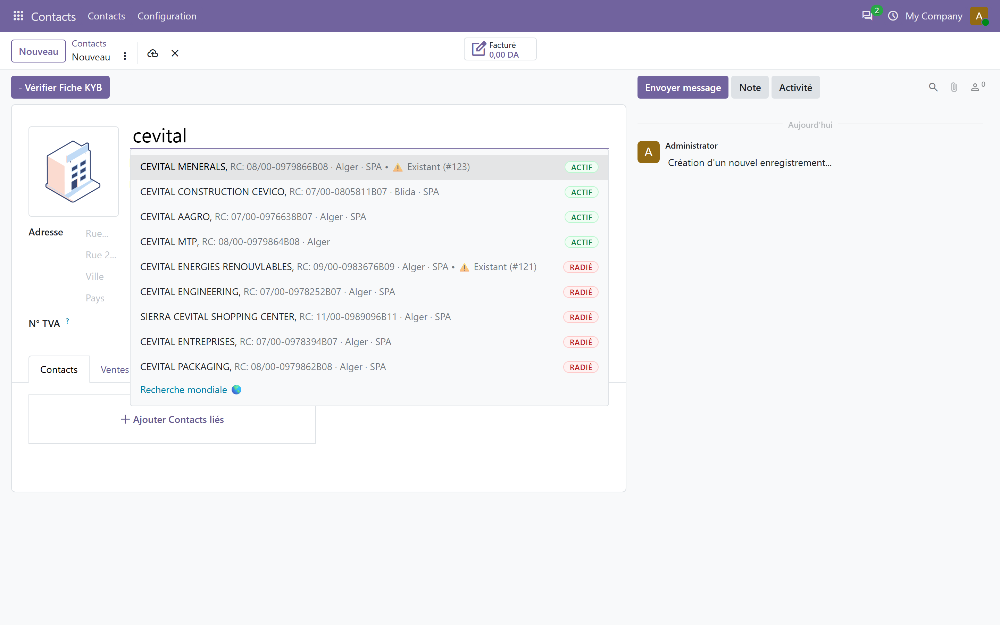
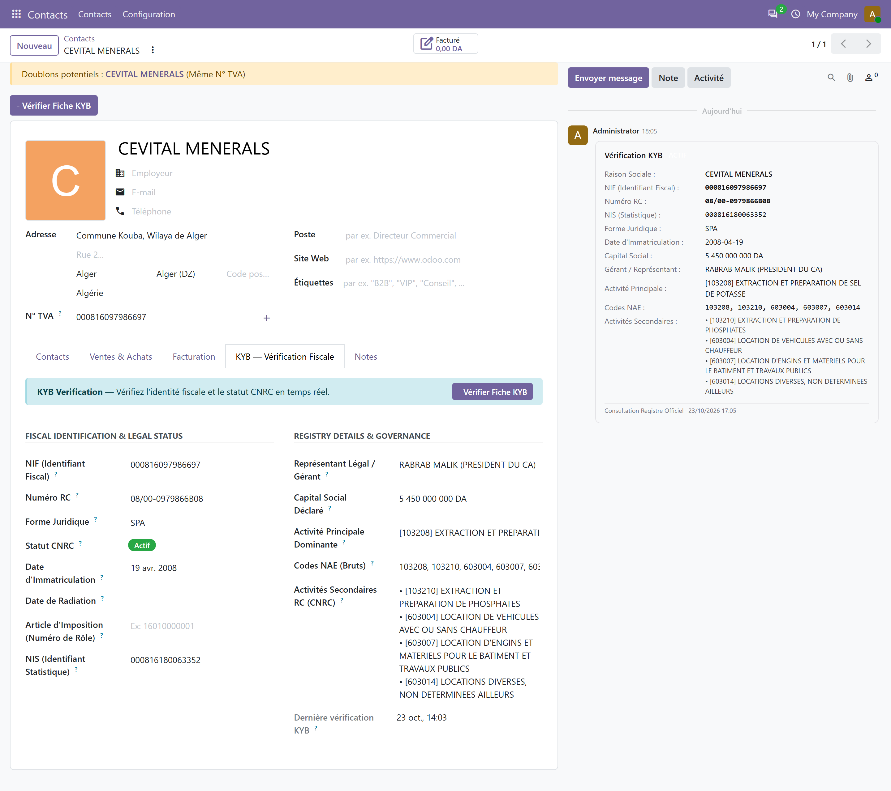

# KYB pour Odoo — Manuel Utilisateur
**Version :** `2.0.4` / `20.0.2.0.4`  
**Cible :** Directeurs Financiers (DAF), Responsables Comptables, Gestionnaires Achats & Ventes  
**Portail KYB (by Digidev) :** [kyb.digidevagency.dz](https://kyb.digidevagency.dz)  
**Compatibilité :** Odoo 16.0 LTS, 17.0, 18.0, 19.0, 20.0 (Community & Enterprise)

---

## 1. À propos du module KYB

Le module **KYB pour Odoo** facilite l'identification de vos tiers et la conformité fiscale de vos pièces comptables en Algérie :

- **Recherche & Auto-complétion Prédictive Instantanée :** Pour les Personnes Morales (sociétés), recherchez par raison sociale (`CEVITAL`) et obtenez instantanément le statut légal (`🟢 Actif` / `🔴 Radié`), la forme juridique, le RC et la wilaya. Pour toutes les entités, recherche directe par **NIF**, **RC** ou **NIS**.
- **Enrichissement Fiscal & Légal Certifié en 1 Clic :** Renseignement automatique de la raison sociale, forme juridique, NIF (15 chiffres), RC normalisé (Décret 05-468), NIS, capital social, dirigeants, adresse du siège et nomenclature NAE.
- **Vérification de Statut Juridique en Temps Réel :** Consultation de l'état officiel (**Actif**, **Radié**, **Suspendu**) avec note d'audit horodatée.
- **Contrôle Temporel des Factures Fournisseurs :** Détection automatique des fournisseurs radiés à la date d'émission de la facture (Articles 169 & 176 CIDTA / Art. 30 CTCA). Alerte ou blocage configurable.
- **Prévention des Doublons Fiscaux :** Alerte immédiate si un NIF existe déjà dans la base, préservant la cohérence de votre grand livre.
- **Hébergement en Algérie (Loi 25-11) :** Infrastructure 100% algérienne opérée au Datacenter d'Algérie Télécom. Zéro données personnelles transmises à l'étranger.

---

## 2. Configuration

La mise en service s'effectue en moins de deux minutes.

### Étape 1 : Installation
1. Dans Odoo, rendez-vous dans **Applications**.
2. Recherchez `KYB` et cliquez sur **Installer**. Aucun redémarrage requis.

### Étape 2 : Obtenir votre Clé d'API
1. Connectez-vous à [kyb.digidevagency.dz](https://kyb.digidevagency.dz).
2. Rubrique **Clés API & Intégrations** → générez votre clé de production (`sk_live_...`).

### Étape 3 : Activer la passerelle dans Odoo
1. Allez dans **Paramètres → KYB Compliance**.
2. Renseignez :
   - **API Key :** Votre clé secrète (affichée masquée `•••••••••`).
   - **Gateway URL :** `https://kyb.digidevagency.dz` (pré-rempli).
   - **Filtre Statut Tiers :** `Toutes les entités` (recommandé) ou `Actives uniquement`.
   - **Politique de Validation des Factures :** `Blocage Strict` (défaut) ou `Avertissement`.
   - **Détection des Doublons NIF :** `Avertissement` (défaut), `Blocage Strict`, ou `Ignorer`.
3. Cliquez sur **Enregistrer**.

*Figure 1 : Interface de configuration KYB — clé d'API, passerelle officielle et politiques de contrôle.*

---

## 3. Recherche & Enrichissement des Sociétés (Personnes Morales)

Lors de la création d'un partenaire (**Contacts → Nouveau**) :

### Étape 1 : Recherche en temps réel par nom (0 Crédit)
1. Cochez **Société**.
2. Saisissez le début de la dénomination (ex : `CEVITAL`).
3. La liste déroulante interroge instantanément le registre central officiel et affiche les entités avec leurs badges légaux (`🟢 Actif` / `🔴 Radié`), wilaya et forme juridique. Les entités actives apparaissent en tête de liste.

> **Gratuité :** La recherche prédictive par nom est incluse à **0 unité** débitée — recherches illimitées.

*Figure 2 : Auto-complétion affichant les entités légales avec badges Actif/Radié, wilaya et forme juridique.*

### Étape 2 : Sélection & enrichissement certifié (1 Crédit)
Cliquez sur l'entité retenue (ex : *CEVITAL MENERALS*) :

- **Raison sociale & Forme juridique** importées (`SPA`, `SARL`, `EURL`...).
- **NIF (15 chiffres)**, **RC normalisé Décret 05-468** et **NIS** insérés.
- **Capital social** et **Représentant Légal** renseignés.
- **Activités NAE** principale et secondaires indexées.
- **Adresse du siège** affectée automatiquement.
- **Badge** `🟢 Actif` ou `🔴 Radié` affiché sur la fiche.

> **Garantie :** 1 crédit est débité uniquement en cas de résultat. Si l'entité est introuvable ou le portail indisponible, un remboursement automatique est crédité immédiatement.

*Figure 3 : Fiche contact enrichie — Onglet KYB affichant les identifiants officiels (RC Décret 05-468, NIF, NIS), le statut ACTIF et la traçabilité d'audit dans le fil de discussion.*

---

## 4. Identification des Commerçants Individuels (Personnes Physiques)

Pour les commerçants individuels, artisans et personnes physiques, la Loi 18-07 encadre la recherche nominale. L'identification se fait par identifiants officiels uniquement.

### Procédure
1. Créez un contact avec l'option **Individu** (`is_company = False`).
2. Saisissez le **NIF individuel à 15 chiffres** (commençant par `1`) ou le **RC Catégorie A ou C** (ex : `26A16208703`).
3. Cliquez sur **Vérifier Fiche KYB** ou tabulation hors du champ.

La fiche est enrichie automatiquement :
- Forme juridique qualifiée `"Personne Physique"`.
- RC normalisé Décret 05-468 (`26/00-16208703A26`).
- Capital qualifié `"N/A (Patrimoine Individuel)"`.
- Titulaire exploitant et activités NAE renseignés.

*Figure 4 : Fiche Personne Physique enrichie — Onglet KYB avec RC Catégorie A, statut ACTIF et note d'audit dans le fil de discussion.*

---

## 5. Prévention des Doublons Fiscaux

Le **NIF** est un identifiant national unique. Les doublons entraînent des éclatements de comptes auxiliaires et faussent l'état 104.

### Comportement selon la politique configurée

| Politique | Comportement |
| :--- | :--- |
| **Avertissement** (défaut) | Bannière d'alerte avec lien vers le contact existant. L'utilisateur peut continuer si nécessaire. |
| **Blocage Strict** | Enregistrement refusé (`UserError`) si un NIF identique existe déjà. |
| **Ignorer** | Aucune vérification (pour structures multi-établissements autorisées). |

### Fusion de contacts existants
1. Sélectionnez les deux fiches dans la liste des contacts.
2. **Action → Fusionner**.
3. Les données KYB (RC, NIF, statut) sont intégralement conservées sur la fiche destination.

*Figure 5 : Boîte de dialogue d'alerte (Pop-up Modal) affichée lors de la détection d'un NIF doublon existant dans la base.*

---

## 6. Contrôle Temporel des Factures Fournisseurs

En droit algérien (Art. 169 & 176 CIDTA / Art. 30 CTCA), les achats auprès d'un fournisseur **radié à la date d'émission** ne sont pas déductibles en IBS ni en TVA.

> [!IMPORTANT]
> L'éligibilité fiscale s'apprécie **à la date exacte d'émission de la facture**, non à la date du paiement. KYB contrôle automatiquement cette concordance.

### Paliers de contrôle

| Palier | Déclencheur | Action |
| :---: | :--- | :--- |
| **1 — Prévention** | À la saisie du fournisseur & de la date | Bannière rouge `🔴 Non Conforme` en tête de facture avant la saisie des montants. |
| **2 — Validation** | Au clic sur **Confirmer** | *Mode Strict :* blocage avec motif. *Mode Avertissement :* validation avec note d'audit. |
| **3 — Clôture mensuelle** | Automatique le 18 du mois | Rapport consolidé des fournisseurs radiés sur la période, avant échéance G50. |

*Figure 6 : Alerte temporelle sur une facture émise après la date de radiation du fournisseur.*

### Vue liste des factures
Dans **Facturation → Fournisseurs → Factures**, la colonne **Conformité Fiscale KYB** affiche :
- `🟢 Conforme` — fournisseur actif, charge et TVA déductibles.
- `🔴 Non Conforme` — risque de rejet fiscal, examen recommandé.

*Figure 7 : Vue synthétique des factures fournisseurs avec indicateurs de conformité fiscale.*

---

## 7. Audit de Fin de Mois (G50)

Pour sécuriser votre déclaration mensuelle :
1. **KYB Compliance → ⚡ Audit Fin de Mois (G50)**.
2. Le système analyse toutes les factures d'achat de la période.
3. Les fournisseurs récemment radiés sont isolés pour assainissement avant dépôt.

---

## 8. Questions Fréquentes

### Utilisation & Gestion au Quotidien

**Que faire lorsqu'une société n'apparaît pas dans l'auto-complétion ?**  
Si une entreprise est de création très récente, s'il s'agit d'une dénomination commerciale abrégée ou en cas de variante orthographique, saisissez directement son **NIF à 15 chiffres** ou son **Numéro RC** dans les champs correspondants du formulaire. Le connecteur interrogera directement le registre central sur ces identifiants officiels uniques.

**Comment identifier un commerçant individuel ou un artisan (Personne Physique) ?**  
Conformément à la Loi 18-07 sur la protection des données personnelles, la recherche nominative prédictive est réservée aux Personnes Morales. Pour un commerçant individuel ou un artisan, cochez **Individu** et effectuez l'identification par son **NIF individuel à 15 chiffres** (commençant par `1`) ou son **Numéro RC Catégorie A ou C** (ex : `16/00-0123456A20`).

**Pourquoi le numéro d'Article d'Imposition (Rôle) n'est-il pas rempli automatiquement ?**  
En vertu de l'**Article 114 du Code des Procédures Fiscales (CPF)**, le Numéro d'Article d'Imposition relève du secret fiscal et n'est pas un identifiant public. Il figure obligatoirement sur les factures imprimées de vos fournisseurs (Décret 05-468). Il vous suffit de le renseigner une seule fois lors du premier traitement de facture : KYB le conserve et l'associe définitivement à la fiche tiers pour vos futures déclarations.

**Que faire si une facture affiche l'alerte « 🔴 Non Conforme (Fournisseur Radié) » ?**  
Cette alerte indique que le fournisseur était officiellement radié des registres (CNRC) à la date d'émission de la facture. En droit fiscal algérien (Articles 169 & 176 CIDTA et Art. 30 CTCA), les charges et la TVA d'un fournisseur radié ne sont pas déductibles. Rapprochez-vous de votre fournisseur pour obtenir une attestation de régularité fiscale récente ou faites valider la pièce par votre direction financière (DAF) selon la politique interne de votre entreprise.

**Comment traiter un doublon fiscal détecté lors de la création d'un contact ?**  
Lorsque la boîte de dialogue signale qu'un NIF existe déjà, vous pouvez annuler la saisie pour utiliser la fiche déjà présente. Si deux fiches ont été créées par inadvertance, sélectionnez-les dans la liste des contacts puis cliquez sur **Action → Fusionner** : l'historique comptable et l'ensemble des données KYB sont intégralement conservés sur la fiche consolidée.

**L'auto-complétion prédictive consomme-t-elle des crédits ?**  
Non. La recherche prédictive par nom et l'affichage des suggestions avec badges légaux sont inclus à **0 crédit** (recherches illimitées). Seul l'enrichissement certifié d'une fiche (clic sur une entité pour importer ses 14 attributs légaux) déduit 1 crédit de votre solde.

**Que se passe-t-il si un enrichissement officiel ne renvoie aucun résultat ?**  
Le système applique la règle stricte du remboursement automatique (*Zero Freebies / Auto-Refund*) : si une entité recherchée par NIF ou RC est introuvable ou si le portail officiel rencontre une indisponibilité momentanée, le crédit prélevé est automatiquement et immédiatement récrédité sur votre compte sans aucune démarche requise.

### Configuration & Administration

**Comment tester le connecteur gratuitement (Mode Sandbox) ?**  
Vous pouvez utiliser la clé d'essai gratuite `sk_test_kyb_sandbox_key_001` ou vos clés de production avec les NIFs déterministes réservés au bac à sable commençant par `0000...` (ex : `000000000000001` pour une société active, `000000000000002` pour une société radiée). Ces requêtes de test ne consomment aucun crédit.

**Comment renouveler ou modifier ma clé d'API KYB ?**  
Connectez-vous sur [kyb.digidevagency.dz](https://kyb.digidevagency.dz) dans la rubrique **Clés API & Intégrations** et générez une nouvelle clé. Dans Odoo, accédez à **Paramètres → KYB Compliance**, collez la nouvelle clé dans le champ **API Key**, puis cliquez sur **Enregistrer**.

**Comment mettre à jour le connecteur KYB vers une nouvelle version ?**  
Dans **Paramètres → KYB Compliance**, cliquez sur le bouton **Vérifier les Mises à Jour**. Si une version supérieure ou un correctif réglementaire est disponible, cliquez sur **Mettre à jour maintenant**. La mise à jour s'effectue en un clic sans interruption de service ni commande terminal.

> [!CAUTION]
> **Ne jamais cliquer sur « Désinstaller ».** La désinstallation supprime physiquement les colonnes KYB dans PostgreSQL (NIF, RC, dates de radiation). Pour mettre à jour, utilisez **toujours** le bouton **Mettre à jour maintenant**.

---

## Support & Assistance

- **Portail officiel :** [https://kyb.digidevagency.dz](https://kyb.digidevagency.dz)
- **Documentation & API :** [https://kyb.digidevagency.dz/docs](https://kyb.digidevagency.dz/docs)
- **Support Client :** support@kyb.digidevagency.dz
